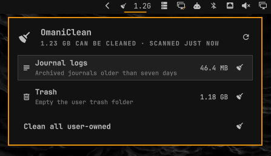

# OmaniClean

An Omarchy Quattro bar plugin that lists usual, non-critical cleanups and how much storage they can free. Nothing runs until you confirm. Privileged work uses `pkexec` so Omarchy's polkit dialog asks for your password.



This plugin never wipes `~/.cache`, never deletes Snapper snapshots, never removes orphan packages, never prunes Docker volumes.

## Install

```sh
omarchy plugin add https://github.com/yooneskh/omaniclean.git --enable
```

## Usage

- Left click the broom to open or close the panel
- Middle click the broom to rescan
- In the panel: `j` / `k` move, Enter cleans the selected row, `r` refreshes, `a` cleans all user-owned rows, Escape closes

Each row shows only if that cache exists and is at least 16 MB, except privileged items whose size cannot be read without root. Those still appear as size unknown.

User-owned rows (trash, thumbnails, AUR builds, language-tool caches) run in the panel after a confirm dialog. Package cache, journal vacuum, and system crash dumps ask through polkit, then rescan when they finish.

## What it can clean

- Extra pacman package versions beyond the last two, plus cached packages you already uninstalled (`paccache -rk2` and `paccache -ruk0`)
- Archived journal files older than seven days
- User trash
- Thumbnail cache
- AUR helper build caches (`yay`, `paru`)
- Regenerable tool caches (pip, npm, cargo, Go build, bun)
- Unused Docker containers, dangling images, and build cache — not volumes
- System crash dumps

## What it never deletes

- Snapper snapshots
- Orphan packages
- Browser profiles or the whole `~/.cache` tree
- Docker volumes or unused tagged images (`docker system prune -a`)
- The last two versions in the pacman cache
- Running processes or RAM page cache (yet)

## Requirements

- Omarchy Quattro with third-party shell plugins
- Optional: `paccache` (from `pacman-contrib`), `docker` on `PATH` if you want those rows (in standard omarchy)

The plugin runs inside `omarchy-shell` as your user. Privileged cleans call system binaries through `pkexec` and wait for the result.

## Remove

```sh
omarchy plugin remove yooneskh.omaniclean
```
